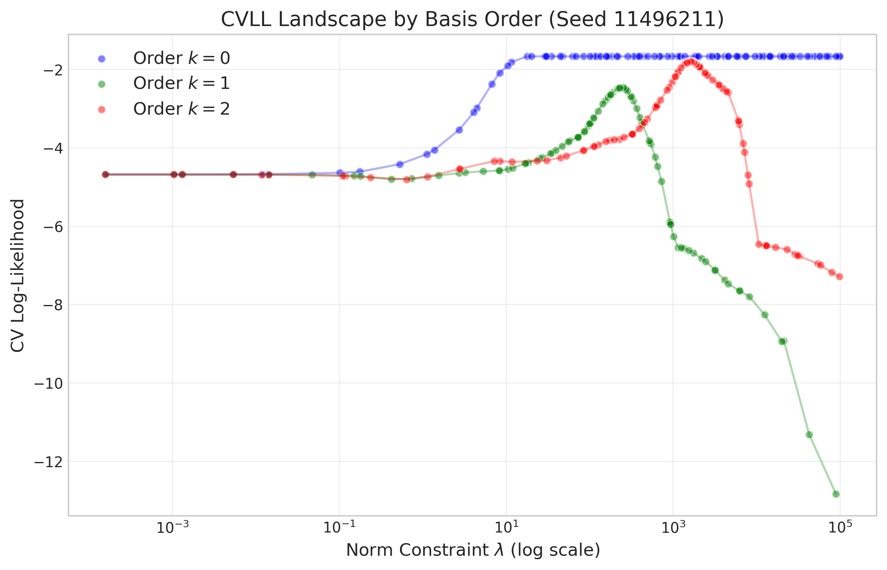
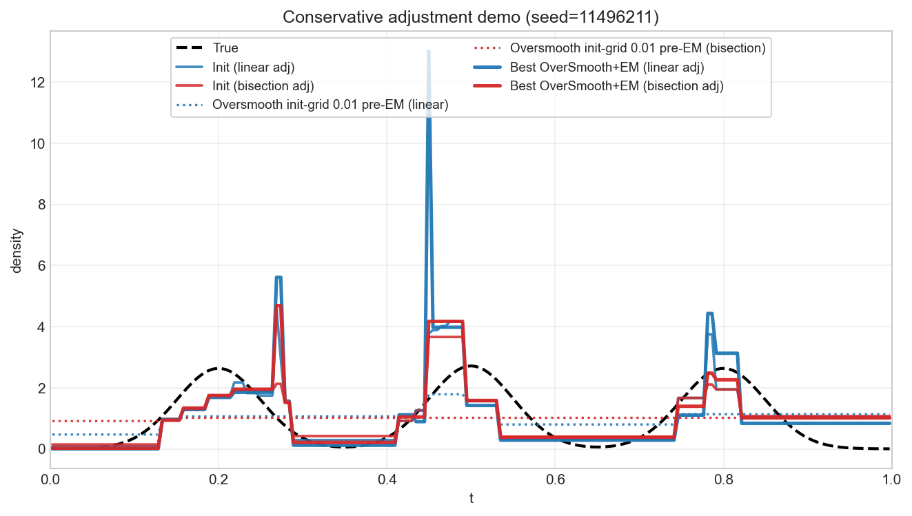
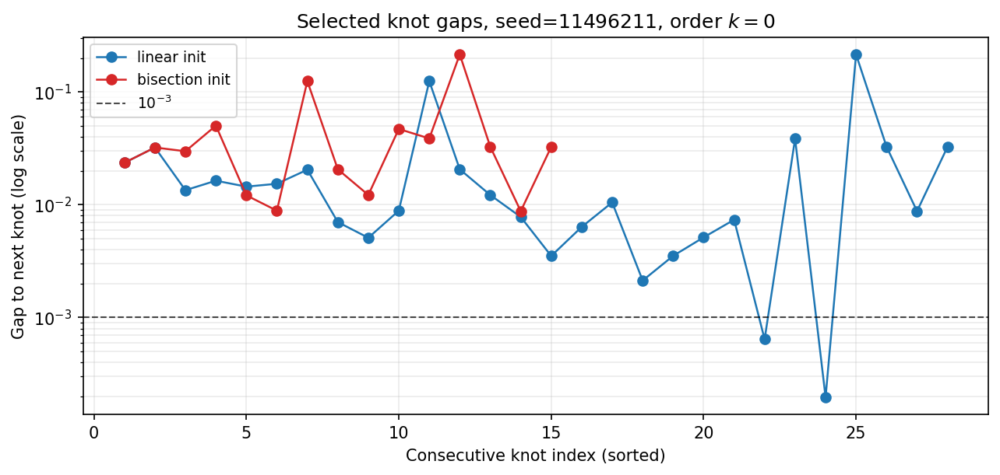
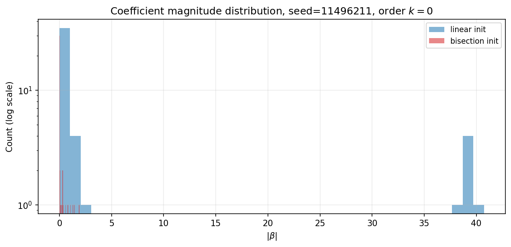
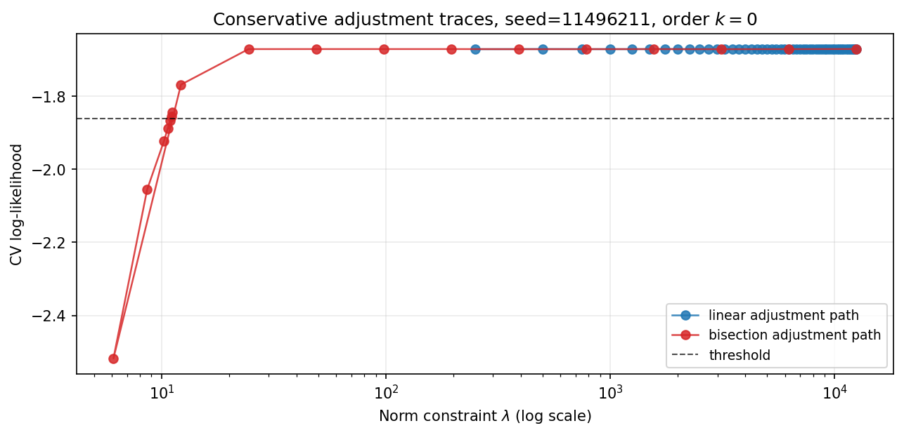

# Multicollinearity in the 0-order HAL basis and the conservative adjustment

Implementation note by Yilong Hou. Source: [`note.tex`](note.tex) with the figures in
[`vis_resource/`](vis_resource/) (build with `latexmk -pdf note.tex`). Below the line is a Markdown
rendering of the note for reading on GitHub; the LaTeX file is authoritative. The experiments in
the note were run on right-censored data (IPCW initial fit followed by EM) before 0.2.0.

## In the package

- The conservative adjustment is `haldensity.core.cv.conservative`: the threshold
  (best mean CV log-likelihood minus 5% of its fold SD by default, or a one-SE rule) and the search
  (geometric bracketing below the CV-selected bound, then bisection in log M to a 2% relative
  tolerance). The censored-data init tuners use it, and from 0.2.0 so does the full-data tuner
  (`OptunaHyperparameterTuner(use_conservative_adjustment=True)`, the default).
- The bisection replaced the linear search as the default; the linear search is reachable only at
  tag `v0.1.0` and in the censored-data tuner base class.

## Follow-up in 0.2.0: where k = 0 spikes come from (full data)

Diagnosed on five simulated data sets (Beta(2, 5) with n = 300 and three seeds, a three-component
Gaussian mixture and a step density with n = 400), `CVXPYEstimator` with k = 0 and M = 50:

- In every case most of the fitted mass (31% to 100%) sits in one cell between two consecutive
  selected knots, 0.0042-0.0049 wide, carried by a cancelling coefficient pair (about +22 / -22).
- The cell is narrower than one cell of the fitting grid (1/199 = 0.005) and contains **no grid
  midpoint**, but it does contain 5-10 data points. Raising the density there increases the
  likelihood of those points while the objective's midpoint normalizer does not see the extra mass
  (its log Z is 0.2 against an exact 18.4 in the worst case), so the objective rewards the spike.
  Evaluated with the exact normalizer, the training log-likelihood of such fits is as low as -16.9.
- `CVXPYEstimator(objective_normalizer="exact")` (k = 0 only) normalizes inside the objective
  exactly, one term per cell between consecutive candidate knots. With it the spikes are gone, and
  the cross-validated log-likelihood (5 folds, exact scoring) rises, peaks at M = 5-23 and then
  declines gradually past the turning point (e.g. 0.506 at M = 10-23 down to 0.03 at M = 10^4),
  instead of collapsing as it does with the midpoint objective (-16 at M = 48). Cost: about 1.1-1.4
  times the fit time at n = 300 and 1.7-2.5 times at n = 1,280. The conservative adjustment stays as
  a safeguard either way.

---

# The Problem: Multicollinearity and Flat CVLL

When using 0-order HAL basis functions (indicator functions / 0-order splines), we encounter multicollinearity when two knots are selected very close to each other. In our experiments (e.g., seed `11496211`), we observed knot gaps smaller than $10^{-3}$.

## Mechanism: Multicollinearity and Budget Waste

When two knots are extremely close (e.g., gap $< 10^{-3}$), the 0-order basis functions become highly correlated. If no validation points fall within this tiny gap, the model can assign large, opposing coefficients (e.g., $+4000$ and $-4000$) to these bases. This configuration cancels out on the observed data, resulting in nearly the same validation likelihood as a model with small coefficients.

However, these large coefficients consume a massive amount of the $L_1$ norm constraint budget. This creates a flat region in the CVLL curve: once the constraint is high enough to fit the signal, further increases are effectively wasted on invisible, cancelling spikes without meaningful improvement in validation likelihood.

#### Verification (Seed 11496211).

In this seed, the linear-adjustment initialization selects two extremely close knot pairs: $$(0.4910696,\,0.4917118), \qquad (0.5301756,\,0.5303721),$$ with minimum gap $1.96\times 10^{-4}$. On this dataset, *there are zero observed times* $T$ falling strictly inside either interval, and the same holds fold-by-fold under the Stage-1 CV splitter (5-fold KFold with shuffle and seed). This makes it possible for the optimization to place large cancelling coefficients on these nearly redundant features without being penalized by the validation log-likelihood.

## Optuna as a Revealer

This behavior is not a fault of Optuna itself; Optuna is revealing a pathology in the objective landscape. Because we define a wide search space for the norm constraint (e.g., $[10^{-3}, 10^5]$) to accommodate multiple basis orders, and because the CVLL curve for $k=0$ is flat after the turning point, many large values appear similarly good. As a result, Optuna can select values that are orders of magnitude larger than necessary (e.g., $80{,}000$ instead of $\approx 10$).

## Verification: Contrast with Higher-Order Bases ($k=1,2$)

This issue is most severe for the 0-order basis. Higher-order splines ($k=1,2$) are less correlated between adjacent features, so their CVLL curves are better behaved: they rise, peak, then gently decline as overfitting begins.

We verified this by running the same experiment (seed `11496211`) with basis orders $k=0,1,2$ and plotting CVLL versus the norm constraint.

<figure id="fig:cvll_by_order">

<figcaption>CVLL landscape by basis order. The <em>k</em> = 0 curve exhibits a long plateau, while <em>k</em> = 1, 2 show clearer peak-and-decline behavior.</figcaption>
</figure>

Figure <a href="#fig:cvll_by_order" data-reference-type="ref" data-reference="fig:cvll_by_order">1</a> shows:

- **Order $k=0$**: the curve rises and then enters a broad plateau (approximately from $\lambda \approx 30$ to $10^5$), so there is no sharp unique optimum.

- **Orders $k=1,2$**: the curves have clearer peaks followed by decline, making the optimal constraint easier to identify.

Consistent with the variation interpretation of HAL norms, the scale of the optimal norm constraint increases with basis order:

- for $k=1$, peak around $\lambda \approx 240$;

- for $k=2$, peak around $\lambda \approx 1600$.

# Impact on EM Algorithm

This bad selection can be catastrophic for the subsequent EM step:

1.  **Initialization:** with a huge norm (e.g., $\sim 12{,}000$), the initial estimator can place excessive mass on tiny intervals (spikes).

2.  **EM iterations:** EM starting from this spiky estimate tends to preserve or amplify this allocation, while fitting the rest of the domain nearly constant.

3.  **Result:** final density quality is severely degraded, sometimes worse than a simple baseline.

# The Fix: Conservative Adjustment

To mitigate this, we use a conservative adjustment strategy: identify the smallest norm constraint on the high-CVLL region near the maximum.

#### Goal.

Find the smallest $\lambda$ such that $$\mathrm{CVLL}(\lambda) \ge \max_{\lambda'} \mathrm{CVLL}(\lambda') - \mathrm{margin},$$ where the margin is typically set as a fraction of the CVLL standard deviation (e.g., $5\%$ of SD).

## Linear Search (Naive)

The initial approach moved from the Optuna-selected value by a fixed relative decrement (e.g., $2\%$ per step, up to 50 steps). If the start is very large (e.g., $12{,}484$), each step is still huge ($\sim 250$), so the search can stop at a still-too-large value ($\sim 250$) and miss the parsimonious region ($\sim 11$).

## Bisection Search (Robust)

Replacing linear movement with bisection gives logarithmic refinement and robust behavior across scales. It can efficiently shrink from very large starts to the smallest acceptable $\lambda$.

# Empirical Results (Seed 11496211)

## Visual Comparison

Figure <a href="#fig:linear_vs_bisection" data-reference-type="ref" data-reference="fig:linear_vs_bisection">2</a> compares the resulting density estimates. The linear adjustment gives a spiky poor fit, while bisection gives a smoother estimate close to truth.

<figure id="fig:linear_vs_bisection">

<figcaption>Density estimates under linear vs. bisection conservative adjustment.</figcaption>
</figure>

## Metric Comparison

| Metric                                          | Optuna (No Adj.) | Linear Adj. (Naive) | Bisection Adj. (Robust) |
|:------------------------------------------------|:----------------:|:-------------------:|:-----------------------:|
| Stage-1 selected norm constraint $\lambda$      |    $12484.06$    |      $249.68$       |         $11.06$         |
| Stage-1 number of selected knots                |       $29$       |        $29$         |          $16$           |
| Stage-1 max coefficient magnitude $\max|\beta|$ |    $2088.71$     |       $40.73$       |         $1.91$          |
| Stage-1 $\ell_1$ norm $\|\beta\|_1$             |    $12485.32$    |      $249.68$       |         $11.06$         |
| Stage-2 best EM KL divergence                   |      $1.03$      |       $1.03$        |         $0.31$          |
| Visual quality (Stage-2 best EM)                | Spiky, poor fit  |   Spiky, poor fit   | Smooth, close to truth  |

Three-way comparison: no conservative adjustment (Optuna-selected $\lambda$), naive linear adjustment, and bisection adjustment. Stage-1 rows summarize the initialization estimator; Stage-2 rows summarize the best OverSmooth+EM result.

In this seed, the Optuna-selected $\lambda$ (no adjustment) yields an initialization with extremely large coefficients (order $10^3$) and a huge $\ell_1$ norm, despite having essentially the same CV objective value as much smaller $\lambda$ values on the plateau. The naive linear adjustment reduces $\lambda$ substantially but can still land on a point that admits tight-knot spikes; the bisection adjustment finds a much smaller $\lambda$ and avoids this pathology.

## Evidence of Multicollinearity

In the linear-adjustment run, the solver selected 29 knots with total norm $\sim 250$. Nearby knot pairs carry large opposite coefficients, suggesting cancellation and budget waste:

| Knot index | Location $t$ | Coefficient $\beta$ |     Gap to next      |
|:----------:|:------------:|:-------------------:|:--------------------:|
|    $21$    |  $0.491070$  |      $+38.08$       | $6.4 \times 10^{-4}$ |
|    $22$    |  $0.491712$  |      $-39.06$       |          …           |
|     …      |      …       |          …          |          …           |
|    $23$    |  $0.530176$  |      $+39.14$       | $2.0 \times 10^{-4}$ |
|    $24$    |  $0.530372$  |      $-40.73$       |          …           |

Example close-knot pairs with large cancelling coefficients in the linear-adjustment solution.

These coefficients (roughly $\pm 40$) consume a large fraction of the norm budget (e.g., $|38| + |-39| \approx 77$) while changing little on observed validation points.

By contrast, the bisection-adjusted solution uses $\lambda \approx 11$, selects only 16 knots, and has maximum coefficient magnitude about $1.91$, preventing this spurious spike behavior.

## Additional Mechanism Evidence

Figure <a href="#fig:knot_gaps" data-reference-type="ref" data-reference="fig:knot_gaps">3</a> shows the consecutive knot gaps for the Stage-1 selected knots: the linear-adjustment initialization contains two gaps below $10^{-3}$ (consistent with the close pairs above), while the bisection-adjustment initialization has none.

<figure id="fig:knot_gaps">

<figcaption>Consecutive knot gaps (sorted) in the selected Stage-1 knot sets. Linear adjustment exhibits two gaps  &lt; 10−3; bisection does not.</figcaption>
</figure>

Figure <a href="#fig:coef_abs_hist" data-reference-type="ref" data-reference="fig:coef_abs_hist">4</a> shows the coefficient magnitude distribution. In the linear-adjustment initialization, the maximum coefficient magnitude is about $40.7$ and roughly $94.5\%$ of the total $\ell_1$ mass is carried by coefficients with $|\beta|>10$, indicating severe budget concentration. In the bisection-adjustment initialization, the maximum coefficient magnitude is about $1.91$ and the fraction above $10$ is $0$.

<figure id="fig:coef_abs_hist">

<figcaption>Histogram of |<em>β</em>| for the Stage-1 coefficient vector (log-count scale). Linear adjustment produces large-magnitude coefficients; bisection adjustment does not.</figcaption>
</figure>

Finally, Figure <a href="#fig:adj_traces" data-reference-type="ref" data-reference="fig:adj_traces">5</a> visualizes the conservative-adjustment trajectories in $(\lambda,\mathrm{CVLL})$ space. The linear search decreases $\lambda$ in coarse multiplicative steps from a very large Optuna proposal (here $\approx 12{,}484$) and can stop at a still-too-large value; bisection efficiently locates a much smaller acceptable $\lambda$ near the turning point.

<figure id="fig:adj_traces">

<figcaption>Conservative adjustment traces on the CVLL landscape (seed 11496211).</figcaption>
</figure>
